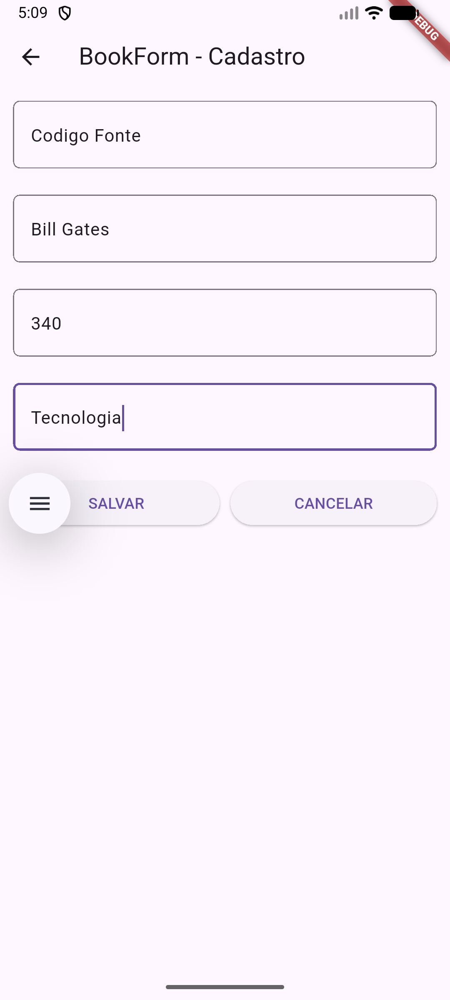
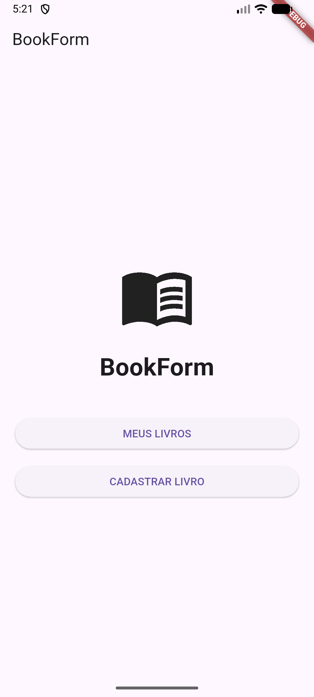
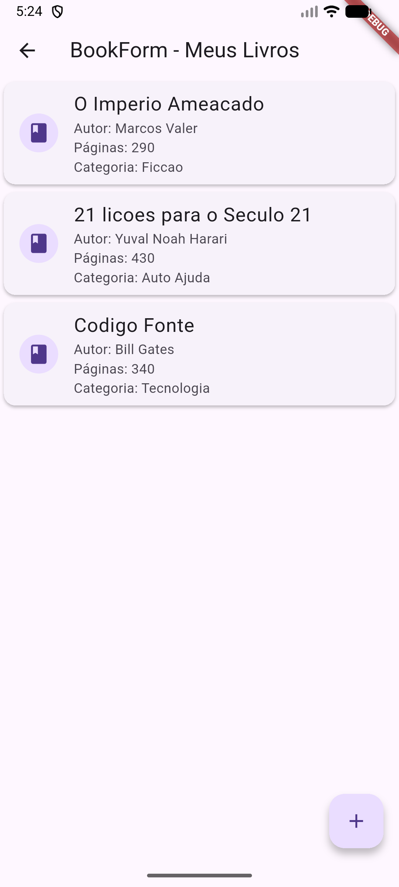

### BookForm
o App consiste em um formulario de cadastro e gerenciamento de listas com banco de dados simples, para cadastro de livros e informações como categorias, autor e numero de páginas

#### Possiveis melhorias:
Implementação de marcador de página para acompanhamento dos livros pode ser implementado no futuro

